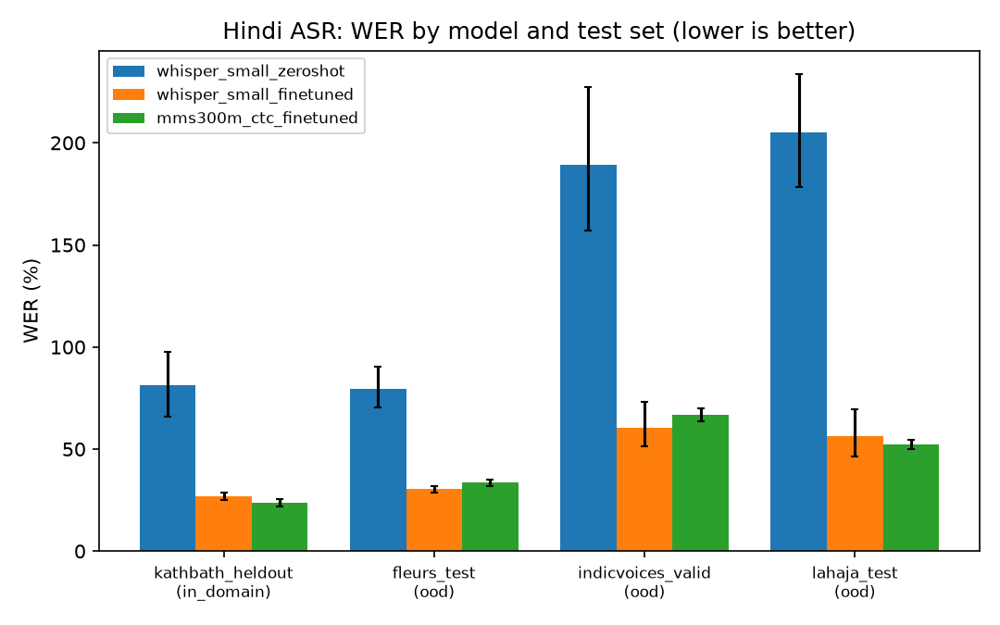
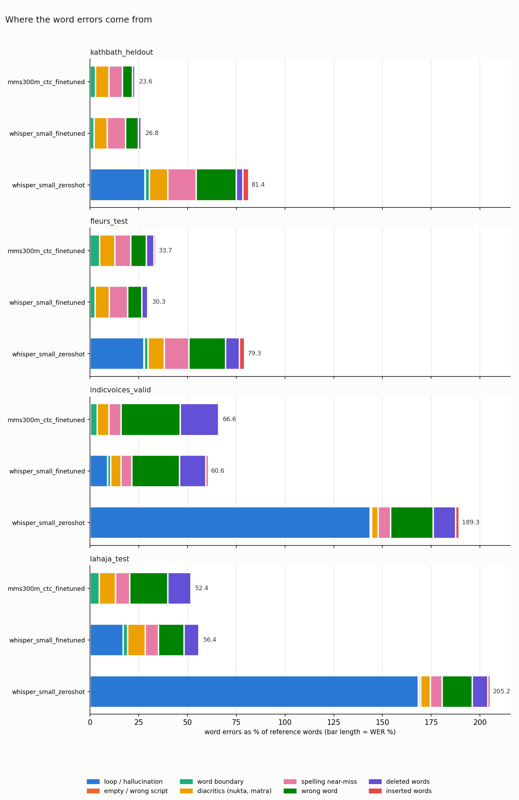
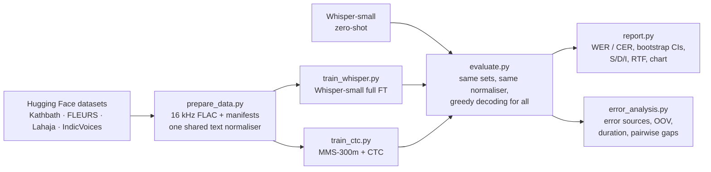

# Hindi ASR: Whisper vs wav2vec2-CTC, in-domain vs out-of-domain

An end-to-end speech-recognition pipeline for **Hindi** that fine-tunes two different architectures on the same
data and compares how they hold up when the test audio shifts away from the training domain. Both are trained
on AI4Bharat's **Kathbath** corpus and evaluated against read-speech, Wikipedia-text, accented and
conversational test sets:

| | Architecture A | Architecture B |
|---|---|---|
| Model | **Whisper-small** (242 M), full fine-tune | **MMS-300m + CTC head** (316 M), full fine-tune |
| Family | encoder–decoder, autoregressive, cross-entropy | encoder-only, non-autoregressive, CTC |
| Has an implicit language model | yes (the decoder) | no |
| Reference row | zero-shot Whisper-small | — |

Training, evaluation and reporting run as resumable stages on **[Modal](https://modal.com)** GPUs (or a local
GPU), with gates (environment check, synthetic smoke test, dataset probe, pilot run) that must pass before
money is spent. A separate **error-analysis tool** attributes every word error to a cause.

> **Scope:** the results below come from the **pilot ("quick") profile**: 10 h of training data, 1 200 / 3 000
> training steps, 200–300 test utterances per set, a single seed. The full 100 h profile is implemented but
> was not run (compute budget). Read the numbers as strong early indications, not final benchmarks.

---

## Results (pilot)

WER % (strictly normalised text), 95 % bootstrap confidence interval in brackets:

| model | Kathbath (in-domain) | FLEURS (text domain) | IndicVoices (spontaneous) | Lahaja (accented) |
|---|---|---|---|---|
| Whisper-small, zero-shot | 81.4 [66.1–97.5] | 79.3 [70.2–90.2] | 189.3 [156.9–227.5] | 205.2 [178.3–233.6] |
| Whisper-small, fine-tuned | 26.8 [24.9–28.8] | **30.3** [28.8–31.9] | **60.6** [51.4–73.2] | 56.4 [46.2–69.4] |
| MMS-300m + CTC, fine-tuned | **23.6** [21.7–25.6] | 33.7 [32.0–35.2] | 66.6 [63.7–70.0] | **52.4** [49.9–54.6] |



### Key findings

* **Fine-tuning on 10 h removed most of zero-shot Whisper's errors**, and most of those errors were
  **hallucinations**. Repetition loops cause 35 % of zero-shot errors on read speech and 76–82 % on
  conversational/accented speech. Zero-shot WER on clips under 3 s reaches 673 %.
* **In-domain the two architectures are statistically indistinguishable.** About 60 % of both models' errors are
  *almost-right* words: one wrong vowel sign, halant or anusvara. That's why CER (7–9 %) is ~3× lower than WER.
* **CTC's weak spot is word boundaries.** Split or merged words explain **179 of CTC's 245 extra errors** on
  FLEURS. Unseen vocabulary is not the cause: FLEURS has 12.4 % OOV tokens vs 10.4 % in-domain.
* **Under accent / spontaneous-speech shift, CTC drops words** (it outputs only 0.79–0.87× the spoken words),
  while **Whisper occasionally hallucinates**. Excluding the 9 Lahaja clips where Whisper loops, Whisper beats
  CTC clearly (40.6 % vs 52.3 %), so CTC's lower overall Lahaja WER comes from a handful of loops.
* **Cost / speed:** CTC decodes ~11× faster (RTF 0.0012 vs 0.014) and can't loop. The pilot's training
  took 0.75 L40S GPU-hours in total (≈ $1.50).



Explanations of *why* an error type occurs (e.g. CTC falling back to the blank symbol on unfamiliar audio, or
Whisper hallucinating on short clips padded to 30 s) are hypotheses consistent with the measurements, not
separately tested.

---

## How it works



**Fair-comparison rules built into the pipeline:** both models use the same audio, the same normalised text
(`src/textnorm.py`, frozen once training starts) and the same test sets. Neither model gets extra tricks
(no LM rescoring, no beam search). Checkpoints are selected on a validation split only, never on a test set.

### Engineering highlights

* **Gated workflow:** environment check → offline smoke test (synthetic "speech" plus tiny random models, so it
  exercises every code path on CPU for cents) → dataset probe → pilot GPU run → cost projection → full run.
* **Found and fixed a CTC decoding bug** that the headline metrics hid: batched CTC decoding also read the
  zero-padding frames, adding junk characters to 16–39 % of transcripts. The fix was verified by comparing
  batched vs single-clip output; in-domain CTC WER went from 27.1 to 23.6 %. The same fix is applied to
  the validation metric used during training.
* **Error attribution tool** (`src/error_analysis.py`): assigns every word error to one cause (hallucination,
  word boundary, diacritics, spelling, wrong word, deletion, ...) using the same alignment as the WER. It's
  checked to reproduce the official WER/CER/S/D/I exactly.
* **Statistics:** utterance-level bootstrap CIs; differences are called only when CIs don't overlap.
* **Cost control:** measured step rates in the pilot and projected the full run (≈ 5 L40S GPU-hours ≈ $10)
  before spending.

---

## Repository structure

```
.
├── README.md
├── requirements.txt             pinned majors: transformers 4.x, datasets 3.x
├── modal_app.py                 Modal wrapper: one function per stage, persistent volume, resumable
├── scripts/
│   ├── run_all.sh               quick | full profile; stages prepare|train_whisper|train_ctc|eval|report
│   └── smoke_test.sh            offline end-to-end test (synthetic audio + tiny models), no token/GPU
├── src/
│   ├── textnorm.py              the single text normaliser (training targets and scoring)
│   ├── metrics.py               WER/CER, S/D/I breakdown, bootstrap CI (validated against jiwer)
│   ├── sources.py               dataset registry and multi-strategy Hugging Face loaders
│   ├── probe_datasets.py        1-example-per-split reachability / auth / column check
│   ├── prepare_data.py          -> data*/<set>/{audio/*.flac, manifest.jsonl, meta.json}
│   ├── train_whisper.py         architecture A (seq2seq)
│   ├── train_ctc.py             architecture B (CTC)
│   ├── evaluate.py              model × set -> predictions + timing
│   ├── report.py                tables, CIs, error breakdown, chart
│   ├── error_analysis.py        error-source attribution, OOV, duration, pairwise gap analysis
│   ├── check_env.py             pre-flight checks
│   └── common.py                shared audio / manifest helpers
├── tests/                       unit tests, synthetic data generator, tiny-model builders
└── assets/                      figures used in this README
```

Generated at run time (not in the repository): `data*/` (audio and manifests), `runs*/` (checkpoints),
`results*/` (predictions, tables, charts, error report), `logs/`.

---

## Reproduce

### Prerequisites
1. A Hugging Face account and read token. Accept the terms on the dataset pages:
   [Kathbath](https://huggingface.co/datasets/ai4bharat/Kathbath),
   [Lahaja](https://huggingface.co/datasets/ai4bharat/Lahaja),
   [IndicVoices](https://huggingface.co/datasets/ai4bharat/IndicVoices).
2. Either a Modal account or a local NVIDIA GPU (≥ 16 GB).

### On Modal (what was used here)
```bash
pip install modal && modal setup
modal secret create huggingface HF_TOKEN=<your token>

modal run modal_app.py --stage smoke                          # offline smoke test (CPU)
modal run modal_app.py --stage prepare --profile quick        # env check, dataset probe, data prep (CPU)
INDIC_GPU=L40S modal run --detach modal_app.py --stage train_whisper --profile quick
INDIC_GPU=L40S modal run --detach modal_app.py --stage train_ctc --profile quick
INDIC_GPU=L40S modal run --detach modal_app.py --stage eval --profile quick
modal run modal_app.py --stage report --profile quick
modal volume get indic-asr-vol results_quick . --force       # download tables, charts, predictions
```
(On Windows PowerShell set the GPU with `$env:INDIC_GPU='L40S'` before `modal run`.)
Monitor with `modal run modal_app.py --stage status`. Every stage is resumable: re-run the same command after
a crash or timeout. Full experiment: the same stages with `--profile full` (100 h, 8 000 / 12 000 steps), or
`modal run --detach modal_app.py --stage all --profile full`.

### On a local GPU
```bash
python -m venv .venv && source .venv/bin/activate
pip install torch --index-url https://download.pytorch.org/whl/cu124   # match your CUDA
pip install -r requirements.txt
python src/check_env.py
bash scripts/smoke_test.sh
bash scripts/run_all.sh quick          # or: full
```

### Error analysis (CPU, seconds)
```bash
python src/error_analysis.py --results results_quick \
    --train_manifest data_quick/kathbath_train/manifest.jsonl \
    --pair whisper_small_finetuned,mms300m_ctc_finetuned \
    --pair whisper_small_finetuned,whisper_small_zeroshot
```
It writes `error_analysis.md`, `error_analysis.json` and `error_sources.png` into the results folder.

---

## Limitations

Pilot scale only (10 h of training data, small test sets, single seed). Kathbath has no official test split
on the Hub, so the in-domain test set is carved from its validation split and isn't guaranteed to be
speaker-disjoint. Greedy decoding and no external LM for CTC. Numerals vs number words aren't reconciled
by the normaliser. Utterances over 30 s are excluded (Whisper's window).

## Acknowledgements

Datasets: [Kathbath](https://huggingface.co/datasets/ai4bharat/Kathbath),
[Lahaja](https://huggingface.co/datasets/ai4bharat/Lahaja) and
[IndicVoices](https://huggingface.co/datasets/ai4bharat/IndicVoices) (AI4Bharat),
[FLEURS](https://huggingface.co/datasets/google/fleurs) (Google).
Models: [openai/whisper-small](https://huggingface.co/openai/whisper-small),
[facebook/mms-300m](https://huggingface.co/facebook/mms-300m).
Datasets and model weights keep their own licences and terms (some are gated or non-commercial); check
each card before reuse. Built with 🤗 Transformers, 🤗 Datasets and Modal.
